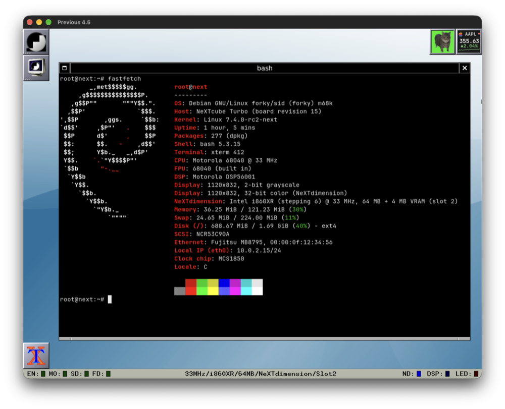

# Linux on NeXT (m68k): tooling



Boot loader, build scripts and emulator setup for bringing up Linux on the
68030/68040 NeXT machines. The kernel work itself is on the `next68k-linux`
branch of https://github.com/dannydorazio/linux (`arch/m68k/next/`,
`CONFIG_NEXT`); the scripts expect it checked out next to this tree, as
`../linux`, and Previous's source as `../trunk`.

## Layout

| Path | What |
|---|---|
| `CLAUDE.md` | How to work in this tree: where things are, ground rules, the emulator's disk-image rules, traps (read by Claude Code at the start of a session) |
| `docs/setup.md` | Setting everything up on a new machine: checkouts, Previous, the build container, the first boot |
| `docs/hardware.md` | What we know about the NeXT hardware and Previous's emulation of it |
| `docs/debugging.md` | How to find out what the kernel, the NeXT or the emulator is doing |
| `docker/Dockerfile` | Debian cross-build environment (`m68k-linux-gnu-gcc`) |
| `loader/` | Linux loader started by the NeXT ROM monitor: `mkimage.py` appends the kernel for netbooting, or the loader alone is a disk's boot block and reads the kernel from the disk's boot partition (`disk.c`, polled SCSI in `scsi.c`) |
| `scripts/build-kernel.sh` | Builds the kernel in the container (objects on the `next68k-kbuild` Docker volume, since this filesystem is case-insensitive) |
| `scripts/rootfs.sh` | Assembles the busybox root file system (used by the two scripts below) |
| `scripts/build-initramfs.sh` | Builds `out/initramfs.cpio.gz`: static busybox (Debian Ports) + `initramfs/` + executables in `tests/` |
| `scripts/build-disk.sh` | Builds `out/disk.img`, a NeXT-labelled SCSI disk: `busybox` (default, 128 MB, partition a = ext4 with the busybox root) or `debian` (2 GB, a = `out/debian-root.img` grown to fit, b = 224 MB swap, c = 32 MB boot partition with the image's kernel, and the loader in the boot blocks, so it boots without the network). Won't replace an existing disk without `FORCE=1` (the old one becomes `out/disk.img.old`) |
| `scripts/update-disk.sh` | Copies `debian-root/` into the existing `out/disk.img`, keeping installed packages and apt state; also the NeXTdimension's X driver if it has been built |
| `scripts/install-packages.sh` | Installs Debian packages into the existing `out/disk.img` on the host (apt under qemu-user), keeping everything else; not kernel packages |
| `scripts/build-dockapps.sh` | Builds the wmoiia and wmaapl dockapps from `../powerbook-debian/tools` for m68k on the host, into `out/dockapps/` |
| `scripts/build-xdriver.sh` | Builds the NeXTdimension's X driver and `tests/xbench.c` for m68k on the host, into `out/xdriver/` (in the dockapps' chroot with `xserver-xorg-dev` added, kept as `out/m68k-xdev.tar.gz`) |
| `scripts/mkdisk.py` | Writes a NeXT disk label (`dlV3`) around partition images, optionally adding a swap partition (`--swap MB`), a boot partition (`--boot MB`) and boot blocks (`--bootblock`); the image stays sparse |
| `scripts/nextboot.py` | For an existing disk: `setup` writes the boot blocks and adds the boot partition (taken from the end of swap if the disk is full), `kernel` writes a kernel ELF file, optional initrd and command line into it |
| `scripts/build-kernel-deb.sh` | Packages the kernel as `out/debs/linux-image-*.deb` (`make bindeb-pkg`) |
| `scripts/build-debian.sh` | Builds `out/debian-root.img`: Debian m68k (Debian Ports, unstable) as ext4, with `debian-root/`, the kernel package, the packages in `debian-packages`, and apt's package lists and caches |
| `debian-packages` | Extra packages for the Debian image, installed on the host (much faster than apt on the NeXT) |
| `debian-root/` | Files laid over the Debian root: hostname, fstab (root and swap), DHCP for eth0, resolv.conf, a longer systemd device timeout, a fastfetch config showing the NeXT hardware, and a kernel hook (`etc/kernel/postinst.d/zz-next-boot`) that copies each installed kernel into the boot partition with the command line in `etc/kernel/cmdline` |
| `scripts/build-image.sh` | Builds the loader and writes the netboot image `out/nfsroot/private/tftpboot/boot` (with the initramfs if built), and the boot block `out/bootblock` |
| `scripts/run-previous.sh` | Netboots that image in Previous (`BOOT=disk` boots from the disk instead, `NET=0` unplugs the Ethernet cable); serial port A (`ttyPZ0`) is the pseudo terminal `out/ttyA`, logged to `out/serial-a.log`, and port B (`ttyPZ1`) is `out/ttyB`, logged to `out/serial-b.log` |
| `scripts/stop-previous.sh` | Stops that Previous (SIGKILL if SIGTERM doesn't do it within 10 s) and checks nothing still has `out/disk.img` open; `run-previous.sh` refuses to start while something does |
| `scripts/screenshot.sh` | Saves the emulated screen to `out/screen.png` (or the file given): Previous writes it on SIGHUP, so it works while the Mac's display is locked |
| `scripts/input.sh` | Types on the emulated NeXT keyboard or moves its mouse (`'type root\n'`, `'key 16'`, `'move 10 -5'`, `'button left down'`): Previous reads the commands from the FIFO `out/input` |
| `scripts/boot-wait.sh` | Starts `run-previous.sh` in the background with the given settings (`MACHINE=turbo BOOT=disk`, ...), waits for a login prompt or a panic and prints the main boot lines |
| `scripts/time-download.sh` | Times a 20 MB HTTP download into the running NeXT, checks its MD5 and shows the Ethernet counters; serves `out/www` on port 8765 |
| `scripts/build-tests.sh` | Builds the test programs in `tests/` as static m68k binaries (the freestanding ones without libc) |
| `scripts/pc2sym.py` | Turns kernel addresses (e.g. PCs logged by temporary code in Previous) into function+offset, counted, from the current `System.map` |
| `scripts/console.py` | Interactive serial console on `out/ttyA` (Ctrl-] quits) |
| `scripts/serial-run.py` | Runs commands over the serial console and prints the transcript (`--port b` for the second port, `--login` to log in as root first) |
| `scripts/sysrq.sh` | Sends a magic SysRq (`t`, `w`, `p`, `m`, ...): Previous turns SIGUSR1 into a serial break |
| `scripts/nmi.sh` | Raises an NMI (Previous turns SIGUSR2 into one): the kernel prints the interrupted registers, even with interrupts off |
| `scripts/build-i860-binutils.sh` | Builds binutils 2.30 for the i860 (the last release with it) into the Docker volume `next68k-i860`, for `nd-firmware/build.sh` |
| `nd-firmware/` | The NeXTdimension's i860 program that draws for the console and for X (`ndfw.s`), and `build.sh`, which assembles it into the kernel's `nextdimension_fw.h` |
| `xorg-nextdimension/` | The NeXTdimension's X driver: X's framebuffer and pixmaps in the board's memory, filled, copied and drawn on by the i860, which also shows them on the screen |
| `initramfs/` | `inittab` and `rcS` for the busybox root file system |
| `tests/regcheck.c` | Checks that syscalls and FPSP emulation preserve user registers |
| `tests/nfsmount.c` | Mounts NFS with text options (busybox's `mount` uses the old binary format) |
| `tests/cascheck.c` | Checks `cas.l` and copy-on-write around page faults and `fork()` |
| `tests/ptdump.c` | Attaches with ptrace and prints a process's registers, user stack and memory (no strace or gdb needed) |
| `tests/drmtest.c` | Shows a test image through the DRM API (`xrgb`, `rgb565`, or `c2`/`c4` with a palette); statically linked, copied to the NeXT over HTTP |
| `tests/scrollbench.sh` | Times how fast the framebuffer console scrolls, with full-width and short lines |
| `tests/xbench.c` | Times fills, scrolling, images, core and Xft text and moving a window in X, in ms per operation (built by `build-xdriver.sh`) |
| `tests/forkabrt.c`, `tests/rwlock.c` | glibc tests for the Debian root: `fork()` then `sigaction(SIGABRT)`, rwlocks and the cached TID |
| `previous/patches/` | Previous patches, one per change, applied in the order of `series` (`previous/README.md` lists them): SCC, ESP and 68040 MMU fixes, Ethernet frames at wire speed, ordered NeXTdimension memory, the host interface the scripts use (serial ports on ptys and logs, break, NMI and screenshot on signals, keyboard and mouse input from a FIFO), and speed (`_setjmp`, idle `stop` skipping, fast-forward, the i860's speed) |
| `previous/patches.py` | Applies the series to Previous (`apply`), or rewrites one patch from a changed Previous tree (`refresh NAME`) |
| `previous/previous.cfg.in` | Previous configuration template, which `run-previous.sh` fills in for the machine chosen: `out/disk.img` as SCSI target 0, boot from Ethernet or the disk, and an optional NeXTdimension |

## Quick start

```sh
docker build -t next68k-build docker
./scripts/build-kernel.sh           # next_defconfig + vmlinux

# busybox for the initramfs (checked against the Debian Ports index)
mkdir -p out/downloads/busybox && (cd out/downloads/busybox && curl -O \
  http://deb.debian.org/debian-ports/pool-m68k/main/b/busybox/busybox-static_1.38.0-3_m68k.deb)
./scripts/build-initramfs.sh
./scripts/build-disk.sh             # SCSI disk image, attached as target 0

./scripts/build-image.sh            # loader + kernel + initramfs
./scripts/run-previous.sh &         # needs Previous with previous/patches (docs/setup.md)
./scripts/console.py                # root shell on the first serial port
```

`run-previous.sh` emulates a NeXTcube with 64 MB by default; `MACHINE=station`
gives a NeXTstation, which Previous limits to 32 MB, `MACHINE=color` a
NeXTstation Color (8 MB SIMMs, 32 MB), `MACHINE=turbo`, `turbo-color` or
`cube-turbo` a 33 MHz Turbo with 128 MB, and `MACHINE=cube030` the original
68030 NeXT Computer (its 1.0 ROM). `ND=1` adds a NeXTdimension board in
slot 2 of a cube and shows its screen instead of the built-in one; it has
16 MB, or 64 MB with `ND_BANK=16`. `ND_SLOTS="4"` puts it in slot 4
instead, `ND_SLOTS="2 4"` one in each (the screen shown is the first's).
Previous gives the board's i860 as many instructions as a 33 MHz one gets;
`I860=4` gives it four times as many and `I860=max` as many as the host
manages (about twice a real one's here).

The emulator runs up to 8 times faster than real time (`FAST=8`, the
default; `FAST=max` for no limit, `FAST=0` for real time). Inside the
machine everything stays consistent, but timings and throughput measured
this way say nothing about a real NeXT. Use `FAST=0` for those. A Debian
boot to a shell takes about 1½ minutes this way instead of 7½.

`build-kernel.sh` passes its arguments to `make`, e.g.
`./scripts/build-kernel.sh menuconfig` or `./scripts/build-kernel.sh vmlinux`.
`build-image.sh` takes `CMDLINE="..."` and `INITRD=/work/<path>`. To use
the disk as the root file system instead of the initramfs:

```sh
./scripts/build-image.sh INITRD= \
    CMDLINE="earlyprintk console=ttyPZ0,9600 root=/dev/sda1 rootwait rw"
```

## Debian

```sh
./scripts/build-kernel-deb.sh       # out/debs/linux-image-*.deb
./scripts/build-debian.sh           # out/debian-root.img (about 4 minutes)
./scripts/build-disk.sh debian      # out/disk.img: root in sda1, swap in sda2,
                                    # boot partition sda3 (needs out/bootblock
                                    # from build-image.sh; FORCE=1 to replace
                                    # an existing disk)
./scripts/build-image.sh INITRD= \
    CMDLINE="earlyprintk console=ttyPZ0,9600 root=/dev/sda1 rootwait rw"
./scripts/run-previous.sh &
./scripts/console.py                # log in as root, password "next"
```

To boot from the disk without the network, as a NeXT on its own would:

```sh
BOOT=disk NET=0 ./scripts/run-previous.sh &
```

The ROM loads the loader from the disk's boot blocks, and the loader reads
the kernel and its command line from the boot partition. Installing a
kernel package on the NeXT (`dpkg -i`, apt) updates the boot partition
through the hook in `debian-root/etc/kernel/postinst.d/`, with the command
line from `/etc/kernel/cmdline`. From the host, with Previous stopped:

```sh
python3 scripts/nextboot.py setup out/disk.img out/bootblock  # once, or after loader changes
python3 scripts/nextboot.py kernel out/disk.img out/vmlinux \
    --cmdline "console=ttyPZ0,9600 root=/dev/sda1 rootwait rw"
```

(`out/vmlinux`: `docker run --rm -v next68k-kbuild:/build -v "$PWD/out":/out
next68k-build cp /build/linux/vmlinux /out/`.) A disk built before the boot
partition existed gets one with `nextboot.py setup`: it takes 32 MB from
the end of swap and rewrites the swap header.

The disk keeps what you install and change on the NeXT. Netbooting doesn't
use the kernel on it, and `./scripts/update-disk.sh` copies
changes in `debian-root/` into it. Packages are much quicker to install
on the host than on the NeXT, where every apt run that changes the dpkg
database takes many minutes at 25 MHz: with the NeXT powered off,
`./scripts/install-packages.sh PACKAGE...` installs them into the disk
(140 packages for X and WindowMaker took about 3 minutes), and listing
them in `debian-packages` puts them in the next image built. Kernel
packages are the exception: install those on the NeXT (`dpkg -i`), whose
hook writes the boot partition.

The screen shows a login prompt too (`getty@tty1`), then xdm's graphical
login on vt7 once X has started (a few minutes at 33 MHz), which starts
WindowMaker (root, "next"); the NeXT keyboard
and mouse work: type into Previous's window, or use `scripts/input.sh`
when there is no window to type into. Add `console=tty0` before `console=ttyPZ0,9600` to get kernel
messages on it as well; the console scrolls at about 30–50 ms per line at
25 MHz, which slows the boot a little. `MACHINE=color` boots the same disk
on a NeXTstation Color, but Debian on 32 MB thrashes until swap is on (see
`ROADMAP.md`); `init=/bin/bash` on the command line is a quick way to try
the display there. While the emulator fast-forwards, a sleeping guest's
clock runs ahead of the wall clock, so a program that shows something "for
10 seconds" may be gone before you look.

xterm uses JetBrains Mono Nerd Font (`debian-root/etc/X11/Xresources/xterm-next`,
always UTF-8, since the locale is C). The font isn't packaged in Debian, so
it's installed by hand: from `JetBrainsMono.tar.xz` of Nerd Fonts v3.5.1
(https://github.com/ryanoasis/nerd-fonts/releases), copy the four
`JetBrainsMonoNerdFontMono-{Regular,Bold,Italic,BoldItalic}.ttf`, and
`JetBrainsMonoNLNerdFontMono-{Regular,Bold}.ttf` for the dockapps below,
to `/usr/local/share/fonts/jetbrains-mono-nerd/` on the NeXT and run
`fc-cache /usr/local/share/fonts`. Without it xterm falls back to DejaVu
Sans Mono.

With a NeXTdimension, X uses the board's own driver (`xorg-nextdimension/`,
picked by `debian-root/etc/X11/xorg.conf.d/20-next.conf`; without it, or
without a board, modesetting). Build it with `./scripts/build-xdriver.sh`,
then `./scripts/update-disk.sh` (or `build-debian.sh`) installs it from
`out/xdriver/`; it has to be built against the X server version on the
disk, which `build-xdriver.sh` prints. X's framebuffer and pixmaps live in
the board's memory, where the i860 fills and copies them and draws
antialiased text, and copies what changed to the screen. Compared with
modesetting (`tests/xbench.c`, `FAST=0`, NeXTcube Turbo with a 64 MB
board), filling a 400x300 rectangle takes 7 ms instead of 830, scrolling
800x584 by a line 45 instead of 545, moving a 400x300 window 32 instead
of 1220, and a line of Xft text 9 instead of 25 (with `I860=max`, fills
and scrolls take half as long again).

Two Window Maker dockapps from `../powerbook-debian/tools` run on it too:
wmoiia (the OIIA cat; click him) and wmaapl (the AAPL quote, from Yahoo
Finance every 5 minutes). `./scripts/build-dockapps.sh` builds them for
m68k on the host into `out/dockapps/` (in a Debian m68k chroot under
qemu-user, kept as `out/m68k-dev.tar.gz`) and lists the packages they need
in `out/dockapps/runtime-packages`. On the NeXT, install the missing ones
(`apt-get install libdockapp3 libcjson1 libcurl4t64`), copy the binaries
to `/usr/local/bin`, and start them in the X session (`wmoiia &`, `wmaapl
-r &`); drag them onto the dock and set "Start when Window Maker is
started" to keep them. Their sources stay in that repository: wmoiia's
sprite comes from a photo of someone's cat.

At real speed (`FAST=0`), a first boot takes about 7 minutes to `login:`,
and logging in another minute and a half; with the default fast-forward,
about 1½ minutes in all.
`sysrq_always_enabled` on the command line lets `scripts/sysrq.sh` work after
systemd has started. `systemd.debug_shell=/dev/ttyPZ1` puts a root shell on
the second serial port (`serial-run.py --port b`) while the login stays on
the first. `systemd.debug_shell=/dev/ttyPZ0
systemd.mask=serial-getty@ttyPZ0.service` puts it on the first port instead.

`fastfetch` shows the NeXT hardware (model, CPU, FPU, DSP, display, SCSI,
Ethernet, clock chip). It doesn't know how to find it on m68k, so
`debian-root/etc/xdg/fastfetch/config.jsonc` reads it from `/proc/hardware`
and `/proc/cpuinfo`.

The freestanding tests (`regcheck`, `cascheck`, `ptdump`, `nfsmount`) are
built with `m68k-linux-gnu-gcc -O2 -m68040 -static -nostdlib -ffreestanding
-fno-stack-protector -fno-pie -no-pie`; the glibc ones (`forkabrt`,
`rwlock`) with plain `m68k-linux-gnu-gcc -O2` and copied into the Debian
root.

## Network

Previous's SLiRP network is 10.0.2.0/24: the NeXT gets 10.0.2.15 by DHCP
(add `ip=dhcp` to the command line), the host is 10.0.2.2 and Previous's
built-in NFS server, which exports `out/nfsroot`, is 10.0.2.254.

The NFS server only speaks NFSv2 and drops pipelined requests over TCP, so
mount over UDP:

```sh
nfsmount 10.0.2.254:/ /mnt \
    vers=2,proto=udp,mountproto=udp,nolock,addr=10.0.2.254,mountaddr=10.0.2.254
```

## Boot flow

1. The ROM does BOOTP and TFTPs `/private/tftpboot/boot` from Previous's
   built-in server (rooted at `out/nfsroot`). The file is an a.out OMAGIC
   image (machine ID 0x87): the ROM loads it at its entry address,
   `0x04380000`, and calls it. Booting from disk, the ROM reads the NeXT
   label, loads the same kind of image, the loader alone, from the boot
   block the label names (at 32 KB, with a copy at 96 KB; the label must
   also name a boot file, which the loader ignores), and calls it with
   `sd()linux`. The loader then finds the first disk with SCSI commands of
   its own, polled, with DMA, and reads the kernel's ELF file from the
   partition of type `boot` into memory as if it had been netbooted.
2. The loader (`loader/main.c`) sizes RAM from the ROM's SIMM table and
   builds the Linux/m68k bootinfo (`MACH_NEXT`, memory chunks, command line,
   `BI_NEXT_*` records). It then copies a small trampoline above everything,
   switches off the caches and the ROM's transparent translation registers,
   and starts the kernel at physical `0x04001000` (virtual `0x1000`).
3. `head.S` maps the device space at `0xf0000000` and drives the SCC for the
   early console.

The kernel command line is `earlyprintk console=ttyPZ0,9600` plus anything
after the boot file in the ROM boot command, e.g. `b en()boot debug`.

## Status

Debian m68k (Debian Ports, sid) boots from the SCSI disk to a login on the
first serial port (`ttyPZ0`) and on the screen, with networking, swap and apt;
the kernel is netbooted or, without the network, loaded from the disk. The busybox
initramfs and disk are still there for quick kernel tests (not rerun since
`CONFIG_VT` was turned off).

- interrupt controller: `arch/m68k/next/ints.c`
- system timer as clockevent, event counter as clocksource:
  `arch/m68k/next/time.c`
- real-time clock (MC68HC68T1 and MCS1850), power-off: `arch/m68k/next/rtc.c`
- reboot through the ROM's reset vector, and `/proc/hardware` (model, board
  revision, clock, memory, display, Ethernet address, on-board chips):
  `arch/m68k/next/config.c`
- both serial ports via `pmac_zilog`
- SCSI via the ESP core, DMA for whole 16-byte bursts and PIO otherwise:
  `drivers/scsi/next_esp.c`
- NeXT disk labels: `block/partitions/next.c`
- MB8795 ethernet with DMA, and the Turbo machines' AT&T 7213:
  `drivers/net/ethernet/next/mb8795.c`
- NeXT DMA channel registers: `arch/m68k/include/asm/nexthw.h`
- the display (2-bit greyscale and 12-bit Color), with fbdev emulation and
  the framebuffer console: `drivers/gpu/drm/tiny/nextdisplay.c`
- keyboard and mouse: `drivers/input/keyboard/nextkbd.c`
- the NeXTdimension board (32-bit color), its console drawn by the board's
  i860 (`nd-firmware/`): `drivers/gpu/drm/tiny/nextdimension.c`; X draws
  with the i860 too (`xorg-nextdimension/`)

Not done yet: sound, floppy, ADB keyboards. Tested in Previous, with
Debian, on the NeXTcube (also with a NeXTdimension), NeXTstation (32 MB),
NeXTstation Color, NeXTstation Turbo, NeXTstation Turbo Color and NeXTcube
Turbo, and the 68030 NeXT Computer (a full systemd boot to a login in about 21 emulated minutes); not on real
hardware. See `ROADMAP.md` for what's next.

## License

Everything in this tree is GPL-2.0 (`LICENSE`), like the kernel; the
loader and most tests also say so in SPDX tags. The patches in `previous/patches/`
change Previous and are GPL-2 like it. NetBSD's next68k port, NeXT's
NeXTdimension sources and Previous were used as references, not copied:
`ROADMAP.md` (Done, step 17) says what each one's license means here and
where the facts taken from NeXT's sources are now cited from.
